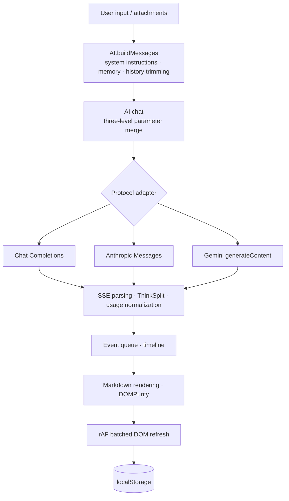

<div align="center">

# PLXT AI Agent

**Zero-build, local-first browser AI Agent with branching conversations, tools, MCP, full parameter control, and more**

[](CHANGELOG.md)
[](LICENSE)
[](#quick-start)
[](#features)
[](CONTRIBUTING.md)

[Quick Start](#quick-start) · [Features](#features) · [Architecture](#architecture) · [Development](#development) · [Deploy](DEPLOY.md) · [Contributing](CONTRIBUTING.md)

</div>

---

Try it now: [PLXT AI Agent Web](https://playlimitxt.github.io/Project/AI/index.html)

PLXT AI Agent is a pure frontend, zero-build AI chat workspace. Conversations, settings, and API keys are stored locally in the browser; model requests are sent directly from the browser to the provider endpoint you configure. There is no self-hosted backend and no dependence on a bundler, framework, or runtime package manager.

Put the entire directory on any static hosting service and it will run; you can also double-click `index.html` to open it via `file://`. The project is aimed at users who need **multi-model comparison, full parameter control, auditable context, and data autonomy**.

> **Privacy note**: No accounts, no self-hosted backend, no telemetry. Conversations and keys are written only to the current browser; model requests go directly to the provider you configure.

## Table of Contents

- [Features](#features)
- [Quick Start](#quick-start)
- [Initial Setup](#initial-setup)
- [Architecture](#architecture)
- [Privacy and External Requests](#privacy-and-external-requests)
- [Project Structure](#project-structure)
- [Development](#development)
- [Deployment](#deployment)
- [Browser Support](#browser-support)
- [Known Limitations](#known-limitations)
- [FAQ](#faq)
- [Contributing and License](#contributing-and-license)

## Features

| Area | Capability |
| --- | --- |
| Multi-model | Chat Completions compatible, Anthropic Messages, and Gemini generateContent adapters; custom Base URL, request headers, request body, and path; configure parameters, unit prices, and capability tags per model; fetch metadata from `/models` |
| Branching conversations | Tree-shaped message structure, regenerate, edit and re-answer, generate new branches with another model, derive new conversations from any node, switch between sibling versions, branch tree view |
| Context | Trim by message count / token budget, keep head and tail, system instruction position, compressed summaries, long-term memory, world book, current time injection, auto title |
| Tools & Agent | Built-in calculation / time / JSON / text tools, web search, MCP Streamable HTTP, tool approval and blocklist, up to 12 rounds of Agent loop |
| Streaming rendering | Thinking, tools, and body text are rendered interleaved in arrival order; streaming Markdown; collapsible thinking area; can actively detach from auto-scroll; abnormally interrupted generation can continue |
| Metering | Prefer `usage` returned by the API (input / output / cache / reasoning); only estimate locally when missing and explicitly mark it |
| Interface | 6 design languages × light/dark modes, responsive layout, keyboard accessible, focus trap, reduced motion, Chinese/English UI |
| Data | Markdown / HTML / TXT / JSONL / CSV / redacted settings export, full JSON backup, logs CSV, QR code configuration sharing, usage charts, activity heatmap, multi-tab sync |
| Security | DOMPurify sanitization, CSP, three key storage modes: local / session / memory-only, global error boundary, redacted export |
| Offline | Service Worker pre-caches the app shell; navigation network-first; offline fallback page; update after user confirmation |

## Quick Start

Node.js 18+ is required only for local preview and self-checks; runtime does not require Node, npm, or a build step.

```bash
# In the repository root
npm run serve
# → http://127.0.0.1:8080/
```

No `npm install` required. You can also use any static server:

```bash
python3 -m http.server 8080
# or
npx serve .
```

Opening `index.html` directly (`file://`) also works; in this mode, Service Worker and PWA installation are unavailable, but all other features are complete.

## Initial Setup

1. Open "Settings → Providers", add a provider, and fill in the Base URL and API Key.
2. Click "Fetch Models" and check the models you want to use; you can also manually enter a model ID.
3. Return to the chat page and select a model in the model selector.
4. Optional: configure web search, MCP services, assistant prompts, appearance, and parameter presets.

Direct browser connections to third-party APIs require cross-origin (CORS) permission from the other party. If the provider does not support it, configure a same-origin reverse proxy as described in [DEPLOY.md](DEPLOY.md).

## Architecture

### Request Flow



### Module Responsibilities

| File | Responsibility |
| --- | --- |
| `index.html` | Single-page entry, single source of branding, CSP, first-frame flash prevention, SVG icons, DOM skeleton |
| `styles.css` | Design tokens, 6 themes, responsive, motion and accessibility styles |
| `js/01-core.js` | Global namespace, state model, storage and migration, conversation tree, parameter parsing, context building, i18n dictionary |
| `js/02-providers.js` | Three-protocol adapters, SSE parsing, `think` splitting, `usage` normalization, retry and timeout, model list |
| `js/03-tools.js` | Built-in tools, MCP client, web search, multi-round Agent loop, tool timeout and sandbox |
| `js/04-render.js` | Message rendering, timeline, Markdown sanitization and decoration, collapsible areas, streaming append, code blocks |
| `js/05-ui.js` | Theme, conversation list, settings page skeleton, command palette, attachments, scroll following, event delegation |
| `js/06-main.js` | Send / generate / stop / continue, branching and comparison, context compression, initialization |
| `js/07-extras.js` | Full settings page, parameter panel, export formats, statistics page, extended actions |
| `js/08-i18n.js` | Chinese/English dictionaries, regex rules, post-DOM translation and MutationObserver |
| `js/09-plus.js` | Enhancement layer: brand filling, model metadata inference, error boundary, PWA, multi-tab sync |
| `sw.js` / `offline.html` | Offline cache and fallback page |
| `scripts/*.mjs` | Zero-dependency local preview and repository self-check |

### Load Order and Enhancement Layer

Scripts are loaded in the order `01` → `09` as classic `defer` scripts, and all mount to `window.AI`. **Later-loaded modules wrap or override functions of the same name from earlier modules**:

- `07-extras.js` wraps `U.renderDrawer`, `U.setBound`.
- `09-plus.js` wraps `AI.load`, `AI.applyStaticI18n`, `U.toggleLang`, `U.renderDrawer`, `U.renderAll`, `U.updateLabels`, `U.applyTheme`, `U.drawerAction`, `U.tab_general`, `U.renderMessages`, `U.modal`, `U.closeModal`.

Before modifying UI functions, first search later files for override points; new logic should preferably go in the corresponding responsibility layer rather than continuing to deepen the wrapping chain. See [AGENTS.md](AGENTS.md) for more maintenance constraints.

### State and Persistence

| Key | Content |
| --- | --- |
| `ai-chat-pro-v3` | Conversation tree, assistants, prompts, memory, providers, settings, logs, usage summary |
| `ai-chat-pro-v3-secrets` | Separately stored sensitive fields (depending on key storage mode) |
| `plxt-ai-chat-v3` | Legacy data migration source |

Key storage supports three modes: `localStorage` / `sessionStorage` / memory-only; quota write failures will show a prompt without interrupting the conversation.

## Privacy and External Requests

- **Local data**: Conversations, settings, prompts, memory, and API keys are by default written only to the current browser's `localStorage`. The project has no self-hosted backend, account system, or cloud sync.
- **No telemetry**: The page does not load visitor analytics or ad scripts, and the first screen requests only same-origin resources; CDNs are accessed on demand only when optional enhancement libraries are used.
- **Direct provider connections**: Model requests, web search, and MCP calls are sent directly from the browser to the endpoints you configure, subject to the target service's CORS policy.
- **CDN enhancement libraries**: `marked` and `DOMPurify` are bundled in `vendor/`. Larger libraries such as code highlighting, KaTeX, Mermaid, pdf.js, mammoth, and QR codes are loaded from jsDelivr / cdnjs / unpkg the first time the corresponding feature is used; put files with the same names in `vendor/` and set `window.AI_OFFLINE_VENDOR = true` to go fully offline.
- **CSP**: The page restricts script and style sources via `meta`, disables `object-src`, and restricts `base-uri`. For the HTTP response header version, CORS reverse proxy, and security headers, see [DEPLOY.md](DEPLOY.md).

For the security model, key boundaries, and vulnerability reporting, see [SECURITY.md](SECURITY.md).

## Project Structure

```text
.
├── index.html                 # Single-page entry, branding, and CSP
├── styles.css                 # Design tokens, themes, responsive
├── manifest.json              # PWA manifest
├── sw.js                      # Service Worker
├── offline.html               # Offline fallback page
├── logo.svg                   # The only Logo file
├── js/
│   ├── 01-core.js             # State, storage, context, i18n
│   ├── 02-providers.js        # Protocol adapters
│   ├── 03-tools.js            # Tools, search, MCP, Agent
│   ├── 04-render.js           # Rendering and sanitization
│   ├── 05-ui.js               # UI skeleton
│   ├── 06-main.js             # Main flow
│   ├── 07-extras.js           # Settings and extensions
│   ├── 08-i18n.js             # Chinese/English dictionaries and post-translation
│   └── 09-plus.js             # Enhancement layer
├── vendor/                    # Local core dependencies and highlight themes
├── scripts/
│   ├── serve.mjs              # Zero-dependency preview server
│   └── check.mjs              # Zero-dependency repository self-check
├── docs/USAGE.md              # Usage instructions
├── .github/                   # CI, Issue / PR templates
├── AGENTS.md                  # Maintenance notes for AI coding agents
├── CONTRIBUTING.md
├── SECURITY.md
├── DEPLOY.md
├── CHANGELOG.md
├── CODE_OF_CONDUCT.md
└── LICENSE
```

## Development

### Commands

| Command | Description |
| --- | --- |
| `npm run serve` | Zero-dependency local preview, default `127.0.0.1:8080`; `npm run serve -- 9090` to specify the port |
| `npm run check` | Repository self-check: syntax, files, version consistency, SW cache manifest, script order, documentation links, license and security invariants |
| `npm run format` | Format with Prettier; requires `npm install` the first time |
| `npm run format:check` | Check formatting without writing |

`serve` and `check` use only Node built-in modules and do not require `node_modules`. CI runs `npm run check` on Node 20 / 22.

### Code Conventions

- Native ES2017: no ESM, optional chaining `?.`, nullish coalescing `??`, TypeScript, or frameworks.
- The global namespace is only `window.AI`; each module uses an IIFE and `'use strict'`.
- Uniformly governed by [.prettierrc.json](.prettierrc.json): single quotes, 120 columns, two spaces, LF.
- Code comments are in English; UI copy is provided in Chinese-English pairs. When adding Chinese copy, sync `AI.LEX` in `08-i18n.js`, or use `L(zh, en)` in `07`/`09`.
- Model output is uniformly processed through `AI.Render.sanitize` (DOMPurify); directly writing to `innerHTML` is prohibited.
- When optional enhancement libraries are missing, it must degrade gracefully and must not throw errors; writes of user data must tolerate quota failures.

### Common Changes

| Need | Locations to sync |
| --- | --- |
| Add script | `defer` order in `index.html` + `SHELL` in `sw.js` |
| Add theme | `AI.DESIGNS` (`01-core.js`) + theme block in `styles.css` + theme array and theme-color mapping in the first-frame guard in `index.html` |
| Version bump | `PLXT_BRAND.version` in `index.html`, `VERSION` in `sw.js`, `manifest.json`, `package.json` (all four consistent) |
| Brand replacement | `window.PLXT_BRAND`, static page meta, `manifest.json`, `offline.html`, `logo.svg`, `sw.js` cache prefix |
| Add protocol | `AI.chat()` branches in `02-providers.js`, tool conversion, and `AI.fetchModels()` |
| Add built-in tool | `AI.BUILTIN_TOOLS` and execution branches in `03-tools.js` |
| Add CDN domain | CSP in `index.html` and `CDN_HOSTS` in `sw.js` |

### Manual Regression

Before committing, check at least:

1. Complete one streaming conversation for each of the three protocols, including one interruption and "Continue Generation".
2. Tool calls and one two-round Agent loop; verify at least one of web search or MCP.
3. After switching between Chinese and English, the UI has no residual Chinese; light / dark themes have no anomalies.
4. Export Markdown / JSON, import configuration (keys redacted).
5. Under HTTP deployment, Service Worker registration, offline fallback, and update prompts.
6. Opening directly via `file://` allows normal conversation.

### Commit Conventions

Use [Conventional Commits](https://www.conventionalcommits.org/): `feat:`, `fix:`, `docs:`, `refactor:`, `test:`, `chore:`. A commit does only one thing, and when runtime files are involved, sync the version number and `CHANGELOG.md`.

## Deployment

- **Static hosting**: Upload the directory as-is; subpath deployment uses relative paths, with no code changes needed.
- **HTTPS**: Prerequisite for PWA installation and Service Worker (except `localhost`).
- **CORS**: When the provider does not support direct browser connections, reverse-proxy the API path to the same origin and fill in the same-origin Base URL.
- **CSP**: Prefer the HTTP response header version to support directives such as `frame-ancestors` and HSTS that `meta` cannot express.
- **Updates**: After each change to JS / CSS, bump the version number in all four places; SW uses network-first for navigation and normally will not get stuck on old cache.

For full configuration (Nginx example, response headers, reverse proxy, caching strategy, removing analytics), see [DEPLOY.md](DEPLOY.md).

## Browser Support

| Browser | Version |
| --- | --- |
| Chromium (Chrome / Edge) | Latest two major versions |
| Firefox | Latest two major versions |
| Safari (macOS / iOS) | Latest two major versions |

Depends on `AbortController`, Fetch Streams, and `backdrop-filter` (progressive degradation). PWA requires HTTPS or `localhost`.

## Known Limitations

- **Pure frontend boundary**: Does not provide server-side authentication, centralized accounts, real-time cross-device sync, server-side vector retrieval, or background push, and cannot bypass third-party CORS.
- **Token budget**: Before a request, it can only estimate by characters; exact counting depends on the `usage` returned by the provider.
- **Cost**: Estimated using local unit prices; may be outdated and does not represent the provider's bill.
- **Protocol differences**: The `usage` fields, SSE termination signals, and error formats of various relays are not unified. The project covers them with multi-field priority and conservative prompts, but it is still recommended to test each real provider one by one.
- **Architecture debt**: `07`/`09` implement enhancements by wrapping functions of the same name; `08` is still a vocabulary list plus post-DOM translation; future versions should be modularized.
- **Uncovered capabilities**: IndexedDB sharded storage, true incremental DOM diff, MCP SSE GET, `n>1` multi-candidate display, tool JSON fallback for models without function calling, and multi-tab merging during generation.

## FAQ

| Issue | Solution |
| --- | --- |
| Cannot connect to the model | Check the Base URL, key, CORS, and model ID; if cross-origin is not supported, configure a reverse proxy |
| Still seeing an old page after deployment | Confirm that the version numbers in all four places have been bumped and refresh; check whether the SW cache has updated |
| Cannot see thinking content | The thinking area is collapsed by default; click the header or press Enter / Space to expand |
| Output stops midway | If the connection closes early, a prompt will appear and "Continue Generation" will be provided; already-generated content will not be rewritten |
| Auto-scroll is pulled back to the bottom | Scrolling up with the wheel / swiping up / PageUp detaches from following; scroll back to the bottom to resume |
| Want to be fully offline | Put optional libraries in `vendor/` and set `window.AI_OFFLINE_VENDOR = true` |
| Want to change branding | Modify `window.PLXT_BRAND` and related static assets; see the table above |

For more usage paths, see [docs/USAGE.md](docs/USAGE.md).

## Contributing and License

- Before participating in development, please read [CONTRIBUTING.md](CONTRIBUTING.md) and [AGENTS.md](AGENTS.md).
- For security issues, report privately according to [SECURITY.md](SECURITY.md); do not publicly submit exploitable details.
- Community behavior follows [CODE_OF_CONDUCT.md](CODE_OF_CONDUCT.md).
- For version change records, see [CHANGELOG.md](CHANGELOG.md).

This project is released under the [MIT License](LICENSE), Copyright © 2026 PlayLimitXT. Third-party libraries in `vendor/` retain their respective licenses; see the corresponding files and upstream projects for details.

---