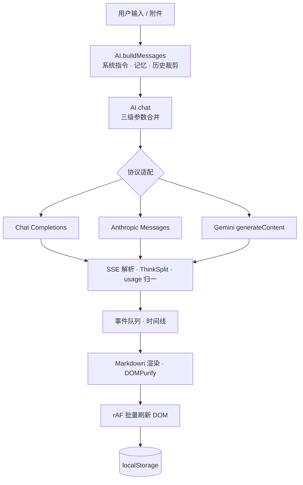

<div align="center">

# PLXT AI Agent

**零构建、本地优先的浏览器 AI Agent，支持分支对话、工具、MCP 和完整参数控制等**<br />
Zero-build, local-first browser AI workspace with branching conversations, tools, MCP and full parameter control.

[](CHANGELOG.md)
[](LICENSE)
[](#快速开始)
[](#功能)
[](CONTRIBUTING.md)

[快速开始](#快速开始) · [功能](#功能) · [架构](#架构) · [开发](#开发) · [部署](DEPLOY.md) · [贡献](CONTRIBUTING.md)

</div>

---

快速体验：[PLXT AI Agent Web](https://playlimitxt.github.io/Project/AI/index.html)


PLXT AI Agent 是一个纯前端、零构建的 AI 对话工作台。会话、配置与 API Key 保存在浏览器本地，模型请求由浏览器直接发往你配置的服务商端点；没有自建后端，也不依赖打包器、框架或运行时包管理。

将整个目录放到任意静态托管即可运行，也可以直接双击 `index.html` 以 `file://` 打开。项目面向需要**多模型对照、完整参数控制、可审计上下文与数据自主**的使用者。

> **隐私提示**：无账号、无自建后端、无遥测。会话与密钥只写入当前浏览器；模型请求直接发往你配置的服务商。

## 目录

- [功能](#功能)
- [快速开始](#快速开始)
- [首次配置](#首次配置)
- [架构](#架构)
- [隐私与外部请求](#隐私与外部请求)
- [项目结构](#项目结构)
- [开发](#开发)
- [部署](#部署)
- [浏览器支持](#浏览器支持)
- [已知边界](#已知边界)
- [常见问题](#常见问题)
- [贡献与许可](#贡献与许可)

## 功能

| 领域 | 能力 |
| --- | --- |
| 多模型 | Chat Completions 兼容、Anthropic Messages、Gemini generateContent 三套适配器；自定义 Base URL、请求头、请求体与路径；按模型配置参数、单价与能力标签；从 `/models` 拉取元数据 |
| 分支对话 | 树状消息结构、重新生成、编辑重答、换模型生成新分支、任意节点派生新会话、兄弟版本切换、分支树视图 |
| 上下文 | 按消息数 / token 预算裁剪、保留首尾、系统指令位置、压缩摘要、长期记忆、世界书、当前时间注入、自动标题 |
| 工具与 Agent | 内置计算 / 时间 / JSON / 文本工具、联网搜索、MCP Streamable HTTP、工具审批与黑名单、最多 12 轮 Agent 循环 |
| 流式渲染 | 思考、工具、正文按到达顺序交错渲染；流式 Markdown；思考区折叠；可主动脱离自动滚动；异常中断可继续生成 |
| 计量 | 优先采用 API 返回的 `usage`（输入 / 输出 / 缓存 / 推理）；仅在缺失时本地估算并显式标注 |
| 界面 | 6 套设计语言 × 明暗模式、响应式布局、键盘可达、焦点陷阱、减少动态效果、中英文界面 |
| 数据 | Markdown / HTML / TXT / JSONL / CSV / 脱敏配置导出、完整 JSON 备份、日志 CSV、二维码配置分享、用量图表、活动热力图、多标签同步 |
| 安全 | DOMPurify 消毒、CSP、密钥本地 / 会话 / 仅内存三种存储模式、全局错误边界、导出脱敏 |
| 离线 | Service Worker 预缓存应用外壳；导航 network-first；离线兜底页；用户确认后更新 |

## 快速开始

需要 Node.js 18+ 仅用于本地预览与自检，**运行时不需要 Node、npm 或构建步骤**。

```bash
# 在仓库根目录
npm run serve
# → http://127.0.0.1:8080/
```

无需 `npm install`。也可以使用任意静态服务器：

```bash
python3 -m http.server 8080
# 或
npx serve .
```

直接打开 `index.html`（`file://`）同样可用；此方式下 Service Worker 与 PWA 安装不可用，其余功能完整。

## 首次配置

1. 打开「设置 → 供应商」，添加供应商，填写 Base URL 与 API Key。
2. 点击「拉取模型」，勾选要使用的模型；也可以手动填写模型 ID。
3. 返回对话页，在模型选择器中选择模型。
4. 可选：配置联网搜索、MCP 服务、助手提示词、外观与参数档位。

浏览器直连第三方 API 需要对方允许跨域（CORS）。若服务商不支持，请按 [DEPLOY.md](DEPLOY.md) 配置同源反向代理。

## 架构

### 请求链路



### 模块职责

| 文件 | 职责 |
| --- | --- |
| `index.html` | 单页入口、品牌单点、CSP、首帧防闪、SVG 图标、DOM 骨架 |
| `styles.css` | 设计令牌、6 套主题、响应式、动效与可访问性样式 |
| `js/01-core.js` | 全局命名空间、状态模型、存储与迁移、会话树、参数解析、上下文构建、i18n 词典 |
| `js/02-providers.js` | 三协议适配器、SSE 解析、`think` 拆分、`usage` 归一、重试与超时、模型列表 |
| `js/03-tools.js` | 内置工具、MCP 客户端、联网搜索、多轮 Agent 循环、工具超时与沙箱 |
| `js/04-render.js` | 消息渲染、时间线、Markdown 消毒与装饰、折叠区、流式追加、代码块 |
| `js/05-ui.js` | 主题、会话列表、设置页骨架、命令面板、附件、滚动跟随、事件委托 |
| `js/06-main.js` | 发送 / 生成 / 停止 / 继续、分支与对比、上下文压缩、初始化 |
| `js/07-extras.js` | 完整设置页、参数面板、导出格式、统计页、扩展动作 |
| `js/08-i18n.js` | 中英文词典、正则规则、DOM 后置翻译与 MutationObserver |
| `js/09-plus.js` | 增强层：品牌填充、模型元数据推断、错误边界、PWA、多标签同步 |
| `sw.js` / `offline.html` | 离线缓存与兜底页 |
| `scripts/*.mjs` | 零依赖本地预览与仓库自检 |

### 加载顺序与增强层

脚本按 `01` → `09` 的顺序以经典 `defer` 方式加载，全部挂载到 `window.AI`。**后加载的模块会包装或覆盖先加载模块的同名函数**：

- `07-extras.js` 包装 `U.renderDrawer`、`U.setBound`。
- `09-plus.js` 包装 `AI.load`、`AI.applyStaticI18n`、`U.toggleLang`、`U.renderDrawer`、`U.renderAll`、`U.updateLabels`、`U.applyTheme`、`U.drawerAction`、`U.tab_general`、`U.renderMessages`、`U.modal`、`U.closeModal`。

修改 UI 函数前，请先在后续文件中搜索覆盖点；新增逻辑应优先放在对应职责层，而不是继续加深包装链。更多维护约束见 [AGENTS.md](AGENTS.md)。

### 状态与持久化

| 键 | 内容 |
| --- | --- |
| `ai-chat-pro-v3` | 会话树、助手、提示词、记忆、供应商、设置、日志、用量汇总 |
| `ai-chat-pro-v3-secrets` | 可分离保存的敏感字段（取决于 Key 存储模式） |
| `plxt-ai-chat-v3` | 旧版数据迁移来源 |

Key 存储支持 `localStorage` / `sessionStorage` / 仅内存三种模式；配额写入失败会提示，不中断对话。

## 隐私与外部请求

- **本地数据**：会话、设置、提示词、记忆与 API Key 默认只写入当前浏览器的 `localStorage`。项目没有自建后端、账号体系或云端同步。
- **无遥测**：页面不加载访问统计或广告脚本，首屏只请求同源资源；使用可选增强库时才会按需访问 CDN。
- **直连服务商**：模型请求、联网搜索与 MCP 调用由浏览器直接发往你配置的端点，受目标服务 CORS 政策约束。
- **CDN 增强库**：`marked` 与 `DOMPurify` 已内置于 `vendor/`。代码高亮、KaTeX、Mermaid、pdf.js、mammoth、二维码等较大库在首次使用对应功能时从 jsDelivr / cdnjs / unpkg 加载；把同名文件放入 `vendor/` 并设置 `window.AI_OFFLINE_VENDOR = true` 可完全离线。
- **CSP**：页面通过 `meta` 限制脚本与样式来源，禁用 `object-src`，并限制 `base-uri`。HTTP 响应头版本、CORS 反代与安全头见 [DEPLOY.md](DEPLOY.md)。

安全模型、密钥边界与漏洞报告方式见 [SECURITY.md](SECURITY.md)。

## 项目结构

```text
.
├── index.html                 # 单页入口、品牌与 CSP
├── styles.css                 # 设计令牌、主题、响应式
├── manifest.json              # PWA 清单
├── sw.js                      # Service Worker
├── offline.html               # 离线兜底页
├── logo.svg                   # 唯一 Logo 文件
├── js/
│   ├── 01-core.js             # 状态、存储、上下文、i18n
│   ├── 02-providers.js        # 协议适配器
│   ├── 03-tools.js            # 工具、搜索、MCP、Agent
│   ├── 04-render.js           # 渲染与消毒
│   ├── 05-ui.js               # 界面骨架
│   ├── 06-main.js             # 主流程
│   ├── 07-extras.js           # 设置与扩展
│   ├── 08-i18n.js             # 中英文词典与后置翻译
│   └── 09-plus.js             # 增强层
├── vendor/                    # 本地核心依赖与高亮主题
├── scripts/
│   ├── serve.mjs              # 零依赖预览服务器
│   └── check.mjs              # 零依赖仓库自检
├── docs/USAGE.md              # 使用说明
├── .github/                   # CI、Issue / PR 模板
├── AGENTS.md                  # AI 编码代理维护须知
├── CONTRIBUTING.md
├── SECURITY.md
├── DEPLOY.md
├── CHANGELOG.md
├── CODE_OF_CONDUCT.md
└── LICENSE
```

## 开发

### 命令

| 命令 | 说明 |
| --- | --- |
| `npm run serve` | 零依赖本地预览，默认 `127.0.0.1:8080`；`npm run serve -- 9090` 指定端口 |
| `npm run check` | 仓库自检：语法、文件、版本一致性、SW 缓存清单、脚本顺序、文档链接、许可证与安全不变量 |
| `npm run format` | 使用 Prettier 格式化；首次需要 `npm install` |
| `npm run format:check` | 检查格式而不写入 |

`serve` 与 `check` 只使用 Node 内置模块，不需要 `node_modules`。CI 在 Node 20 / 22 上运行 `npm run check`。

### 代码约定

- 原生 ES2017：不使用 ESM、可选链 `?.`、空值合并 `??`、TypeScript 或框架。
- 全局命名空间仅 `window.AI`；每个模块使用 IIFE 与 `'use strict'`。
- 统一由 [.prettierrc.json](.prettierrc.json) 约束：单引号、120 列、两空格、LF。
- 代码注释使用英文；界面文案中英文成对提供。新增中文文案时同步 `08-i18n.js` 的 `AI.LEX`，或在 `07`/`09` 中使用 `L(zh, en)`。
- 模型输出统一经 `AI.Render.sanitize`（DOMPurify）处理，禁止直接写入 `innerHTML`。
- 可选增强库缺失时必须降级，不得抛错；用户数据写入需容忍配额失败。

### 常见改动

| 需求 | 需要同步的位置 |
| --- | --- |
| 新增脚本 | `index.html` 的 `defer` 顺序 + `sw.js` 的 `SHELL` |
| 新增主题 | `AI.DESIGNS`（`01-core.js`）+ `styles.css` 主题块 + `index.html` 首帧守卫中的主题数组与 theme-color 映射 |
| 版本升级 | `index.html` 的 `PLXT_BRAND.version`、`sw.js` 的 `VERSION`、`manifest.json`、`package.json`（四处一致） |
| 品牌替换 | `window.PLXT_BRAND`、页面静态 meta、`manifest.json`、`offline.html`、`logo.svg`、`sw.js` 缓存前缀 |
| 新增协议 | `02-providers.js` 的 `AI.chat()` 分支、工具转换与 `AI.fetchModels()` |
| 新增内置工具 | `03-tools.js` 的 `AI.BUILTIN_TOOLS` 与执行分支 |
| 新增 CDN 域 | `index.html` 的 CSP 与 `sw.js` 的 `CDN_HOSTS` |

### 手动回归

提交前至少检查：

1. 三个协议各完成一次流式对话，包含一次中断与「继续生成」。
2. 工具调用与一次两轮 Agent 循环；联网搜索或 MCP 至少验证一项。
3. 中英文切换后界面无残留中文；浅色 / 深色主题无异常。
4. 导出 Markdown / JSON，导入配置（密钥脱敏）。
5. HTTP 部署下 Service Worker 注册、离线兜底与更新提示。
6. `file://` 直开可正常对话。

### 提交规范

使用 [Conventional Commits](https://www.conventionalcommits.org/)：`feat:`、`fix:`、`docs:`、`refactor:`、`test:`、`chore:`。一个提交只做一件事，并在涉及运行时文件时同步版本号与 `CHANGELOG.md`。

## 部署

- **静态托管**：原样上传目录；子路径部署使用相对路径，无需改代码。
- **HTTPS**：PWA 安装与 Service Worker 的前提（`localhost` 除外）。
- **CORS**：服务商不支持浏览器直连时，将 API 路径反代到同源，并填写同源 Base URL。
- **CSP**：优先使用 HTTP 响应头版本，以支持 `frame-ancestors`、HSTS 等 `meta` 无法表达的指令。
- **更新**：每次改动 JS / CSS 后同步升级四处版本号；SW 对导航采用 network-first，正常不会卡旧缓存。

完整配置（Nginx 示例、响应头、反代、缓存策略、移除统计）见 [DEPLOY.md](DEPLOY.md)。

## 浏览器支持

| 浏览器 | 版本 |
| --- | --- |
| Chromium（Chrome / Edge） | 最近两个主版本 |
| Firefox | 最近两个主版本 |
| Safari（macOS / iOS） | 最近两个主版本 |

依赖 `AbortController`、Fetch Streams、`backdrop-filter`（渐进降级）。PWA 需要 HTTPS 或 `localhost`。

## 已知边界

- **纯前端边界**：不提供服务端鉴权、集中账号、跨设备实时同步、服务端向量检索、后台推送，也不能绕过第三方 CORS。
- **Token 预算**：请求前只能按字符估算，精确计数依赖服务商返回的 `usage`。
- **费用**：按本地单价估算，可能过时，不代表服务商账单。
- **协议差异**：各家中转的 `usage` 字段、SSE 终止信号与错误格式不统一，项目以多字段优先级与保守提示覆盖，仍建议对真实服务商逐一联调。
- **架构债**：`07`/`09` 通过同名函数包装实现增强，`08` 仍为词表加后置 DOM 翻译；后续版本宜模块化。
- **未覆盖能力**：IndexedDB 分片存储、真正的增量 DOM diff、MCP SSE GET、`n>1` 多候选展示、无 function calling 模型的工具 JSON 回退、多标签生成期合并。

## 常见问题

| 问题 | 处理 |
| --- | --- |
| 连不上模型 | 检查 Base URL、Key、CORS 与模型 ID；不支持跨域时配置反代 |
| 部署后仍是旧页面 | 确认四处版本号已升级并刷新；检查 SW 缓存是否更新 |
| 看不到思考内容 | 思考区默认折叠，点击头部或按 Enter / 空格展开 |
| 输出中途停止 | 连接提前关闭会提示并提供「继续生成」；已生成内容不会被改写 |
| 自动滚动被拉回底部 | 向上滚轮 / 上滑 / PageUp 即脱离跟随；滚回底部恢复 |
| 想完全离线 | 将可选库放入 `vendor/`，设置 `window.AI_OFFLINE_VENDOR = true` |
| 想换品牌 | 修改 `window.PLXT_BRAND` 与相关静态资源；见上表 |

更多操作路径见 [docs/USAGE.md](docs/USAGE.md)。

## 贡献与许可

- 参与开发前请阅读 [CONTRIBUTING.md](CONTRIBUTING.md) 与 [AGENTS.md](AGENTS.md)。
- 安全问题请按 [SECURITY.md](SECURITY.md) 私下报告，不要公开提交可利用细节。
- 社区行为遵循 [CODE_OF_CONDUCT.md](CODE_OF_CONDUCT.md)。
- 版本变更记录见 [CHANGELOG.md](CHANGELOG.md)。

本项目以 [MIT License](LICENSE) 发布，Copyright © 2026 PlayLimitXT。`vendor/` 中的第三方库保留各自许可证，详见对应文件与上游项目。

---

### English summary

PLXT AI Agent is a zero-build, local-first AI chat workspace that runs entirely in the browser. It supports OpenAI-compatible, Anthropic and Gemini endpoints, branching message trees, full sampling controls, built-in tools, web search, MCP and multi-round agent loops. Conversations, settings and API keys stay in local browser storage; there is no backend, no account system and no telemetry. The app ships as static HTML/CSS/JavaScript and can be served from any static host or opened directly via `file://`. Licensed under MIT.